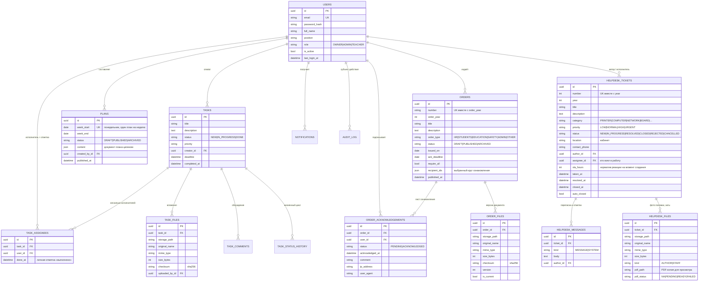

# Архитектура SchoolHub

Документ описывает модель данных, ключевые проектные решения (в формате лёгких ADR)
 и то, как реализовано разграничение доступа.

---

## 1. Общая схема

```
                        ┌─────────────────────────────────────────────┐
                        │                 Клиент (SPA)                │
                        │  React 18 + TS + TanStack Query + Router    │
                        │  ─────────────────────────────────────────  │
                        │  store/auth  ← JWT (access в памяти/session,│
                        │                refresh в localStorage)      │
                        │  lib/permissions ← capabilities из /auth/me │
                        └───────────────────┬─────────────────────────┘
                                            │ JSON / multipart / blob
                        ┌───────────────────▼─────────────────────────┐
                        │            nginx (prod) / vite (dev)        │
                        │   статика SPA + reverse-proxy /api → :8000  │
                        └───────────────────┬─────────────────────────┘
                                            │
┌───────────────────────────────────────────▼───────────────────────────────────────────┐
│                              FastAPI (uvicorn, async)                                  │
│                                                                                       │
│  api/       маршруты + RBAC-зависимости + сериализация (Pydantic)                     │
│    ├── auth.py       login / refresh / me / change-password / logout                  │
│    ├── users.py      справочник сотрудников, управление учётками                      │
│    ├── orders.py     приказы, файлы, ознакомление, CSV-экспорт                        │
│    ├── tasks.py      задачи, статусы, комментарии                                     │
│    └── misc.py       уведомления, аудит, дашборд, справочники                         │
│                                                                                       │
│  services/  бизнес-логика (не знает про HTTP)                                         │
│    ├── orders.py     жизненный цикл приказа, круг ознакомления, версии файлов         │
│    ├── tasks.py      scope-фильтры, state machine, вычисление OVERDUE                 │
│    ├── notifications.py  in-app события                                               │
│    ├── audit.py      журнал + diff                                                    │
│    ├── storage.py    FileStorage (локальная ФС, S3-ready), валидация MIME/размера     │
│    └── documents.py  отдача/превью, конвертация DOCX→PDF (LibreOffice, опц.)          │
│                                                                                       │
│  security.py      JWT, bcrypt, require_role(), get_current_user, client_meta()        │
│  capabilities.py  матрица «роль → возможности» (единый источник для API и UI)         │
│  models/ schemas/ enums.py types.py dbutils.py errors.py config.py                    │
└──────────────┬───────────────────────────────────────┬────────────────────────────────┘
               │ asyncpg                               │ файловая система
       ┌───────▼────────┐                    ┌─────────▼──────────┐
       │ PostgreSQL 16  │                    │ storage/uploads/   │
       │ (SQLite в CI)  │                    │  <yyyy>/<mm>/<uuid>│
       └────────────────┘                    └────────────────────┘
```

**Правило зависимостей:** `api → services → models`. Сервисы не импортируют `fastapi`
(кроме `UploadFile` как носителя байтов), роутеры не содержат бизнес-правил — только
проверки прав, маппинг параметров и сериализацию. Это позволяет переиспользовать сервисы
из CLI, планировщика и тестов.

---

## 2. Модель данных



Индексы: `users.email`, `orders(number, order_year)` (unique), `orders(issued_on, order_type, status)`,
`order_acknowledgements(order_id, user_id)` (unique), `task_assignees(task_id, user_id)` (unique),
`task_assignees(user_id)`, `tasks(status, deadline)`, `plans(week_start)` (unique), `plans(status)`,
`audit_log(action, entity_type, created_at)`, `notifications(user_id, is_read)`,
`helpdesk_tickets(number, year)` (unique), `helpdesk_tickets(status, priority)`,
`helpdesk_tickets(assignee_id)`, `helpdesk_tickets(author_id, created_at)`,
`helpdesk_messages(ticket_id, created_at)`, `helpdesk_files(ticket_id)`.

**PDF-копия у каждого вложения (v1.12).** Четыре таблицы файлов — `order_files`
(исторически без копии), `task_files`, `service_note_files`, `help_article_files`,
`helpdesk_files` — несут одинаковый набор колонок `pdf_path`, `pdf_size`,
`pdf_status`, `pdf_note`. Общий код работает с ними duck-typing'ом
(`app/services/document_pdf.py` принимает любой объект с этими полями), а не
наследованием: таблицы принадлежат разным модулям, и общая база-миксин тянула бы
за собой связи между ними.

**План работы — JSON-документ, а не набор таблиц.** `plans.content` хранит документ целиком
(дежурство, блоки «в течение месяца/недели», мероприятия по дням с ответственными-UUID).
План всегда читается и пишется целиком и занимает ~40 строк в год, поэтому нормализация
не даёт выигрыша ни в запросах, ни в целостности; структура строго валидируется
Pydantic-схемами (`app/schemas/plan.py`), а ссылки на сотрудников проверяются сервисом
при каждом сохранении. Ответственные собираются обходом документа (`Plan.responsible_ids()`)
и используются для уведомлений при публикации и для счётчика «моих пунктов».

---

## 3. Ключевые решения (ADR)

### ADR-01. «Просрочена» — вычисляемое состояние, а не значение колонки

**Контекст.** ТЗ требует 4 статуса задачи: Новая, В работе, Выполнена, Просрочена.
Первые три — результат действия пользователя, четвёртый наступает **сам** по истечении срока.

**Проблема хранения.** Если `OVERDUE` писать в БД, данные устаревают без внешнего воздействия:
нужен cron/воркер, который каждые N минут переводит задачи в просрочку. Между тиками воркера
статус врёт, а при отказе воркера система «залипает».

**Решение.** В БД хранится только `NEW | IN_PROGRESS | DONE`, а просрочка вычисляется:

```python
def is_overdue(task, now):
    return bool(task.deadline and task.status != DONE and task.deadline < now)
```

* в SQL — предикатом (`deadline IS NOT NULL AND deadline < now AND status != 'DONE'`),
  поэтому фильтры и счётчики работают на стороне БД и корректно пагинируются;
* в API — полями `effective_status`, `is_overdue`, `days_left`;
* в UI — отдельной вкладкой/колонкой и красным бейджем.

**Следствие.** Статус всегда актуален, воркеры не нужны, переход «просрочена → выполнена»
не требует записи (достаточно `DONE`). Плата — чуть более сложный предикат в запросах
и правило «просроченная задача не учитывается в счётчиках NEW/IN_PROGRESS»
(иначе одна задача попадала бы в две вкладки).

---

### ADR-02. RBAC: декларативные зависимости + capabilities-контракт

**API.** Права объявляются в сигнатуре маршрута, поэтому проверка выполняется **до** бизнес-логики:

```python
router = APIRouter(prefix="/users", dependencies=[Depends(require_role(Role.ADMIN))])  # ADMIN и OWNER
ManagerDep = Annotated[User, Depends(require_role(Role.ADMIN))]                        # внутри orders/tasks

async def create_order(payload: OrderCreateIn, session: SessionDep, manager: ManagerDep): ...
```

`require_role(min_role)` использует иерархию `ROLE_LEVEL` (`TEACHER=1 < ADMIN=2 < OWNER=3`)
и сравнивает «не ниже», а не «равно» — частый источник багов в подобных гейтах.

Точечные правила, которые не описываются одной ролью, живут в сервисах и возвращают 403/409:

| Правило | Где |
|---|---|
| Учитель видит только свои задачи | `tasks.scope_filter()` — применяется и к списку, и к счётчикам, и к отчётам |
| Учитель не меняет исполнителя/дедлайн/приоритет | `tasks.update_task()` — whitelist полей |
| Комментировать могут только участники задачи | `tasks.add_comment()` |
| Подтвердить ознакомление может только участник круга | `orders.acknowledge()` |
| Издатель не входит в круг ознакомления | `orders._resolve_recipients()` |
| Нельзя выдать роль своего уровня и выше | `security.can_manage_role()` |
| Админ не видит и не редактирует Владельца | `users._visible_scope()` |
| В школе всегда ≥ 1 активного Владельца | `users.update_user()` |

**UI.** Сервер отдаёт в `GET /auth/me` список `capabilities` (строки вроде `orders:manage`),
а на клиенте `lib/permissions.ts` решает, какие разделы и кнопки показывать. Матрица доступна
через `GET /meta/permissions` и отображается в профиле — расхождение между UI и API исключено,
потому что источник один.

**Почему не таблицы `roles`/`permissions`.** Ролей три, они зафиксированы ТЗ, а проверки должны
быть дешёвыми и типизированными. Динамические права добавляются миграцией: таблица `permissions`
+ связь `role_permissions`, при этом словарь `capabilities` остаётся тем же контрактом для UI.

---

### ADR-03. Ознакомление как отдельная сущность (лист ознакомления)

Вместо флага «прочитано» на приказе создаётся строка `order_acknowledgements` на каждого
подписчика — это даёт:

* прогресс и список неподписавших без отдельных запросов;
* юридически значимый след: время, IP, User-Agent, комментарий;
* идемпотентность: `sync_acknowledgements()` приводит лист в соответствие с кругом
  (при смене списка удаляются только **неподписанные** строки — уже подтверждённые остаются как факт);
* повторное подтверждение отклоняется (409), «отозвать» подпись нельзя — только новый приказ.

Круг подписчиков формируется при публикации: `require_all=true` → все активные сотрудники,
кроме Владельца; иначе — явно переданный список `user_ids`. Издатель в круг не входит:
он подписал документ фактом издания.

---

### ADR-04. Файлы: версионирование и абстракция хранилища

* Путь в хранилище **генерирует сервер** (`<yyyy>/<mm>/<uuid>.<ext>`), клиентское имя файла
  используется только для отображения → исключены коллизии и path traversal
  (дополнительно `abspath()` проверяет, что итоговый путь лежит внутри корня).
* Загрузка нового файла не затирает старый, а создаёт версию (`version`, `is_current`),
  сохраняется sha256 — можно доказать, какой именно документ подписали сотрудники.
* Валидация: whitelist MIME (PDF/DOCX/DOC), лимит размера (потоково, с удалением огрызка),
  отказ на пустой файл.
* `FileStorage` — Protocol; `LocalFileStorage` реализован, `S3FileStorage` объявлен как точка
  расширения. Переход на MinIO/S3 не затрагивает сервисы и роутеры.
* Отдача файла — `FileResponse` с `Content-Disposition` (`inline` для PDF-превью,
  `attachment` для скачивания) и заголовком `X-Content-Type-Options: nosniff`.
  Клиент получает blob с заголовком `Authorization` (в `<iframe src>` заголовок не передать).

---

### ADR-05. Асинхронный стек и дисциплина загрузки связей

Весь путь от драйвера (`asyncpg`/`aiosqlite`) до роутеров — async. Из этого следует правило:
**никакой ленивой загрузки вне greenlet-контекста**. Практические следствия в коде:

* нужные связи объявлены как `lazy="selectin"` / `lazy="joined"`;
* после `flush()`/`refresh()` роутер явно перечитывает агрегат (`session.refresh(order)`),
  прежде чем сериализовать;
* CSV-экспорт строится **плоским** запросом с JOIN по конкретным колонкам: `FileResponse`
  стримится уже после возврата из хендлера, и ленивая подгрузка связи там недопустима.

---

### ADR-06. Портируемость между PostgreSQL и SQLite

Один и тот же код работает на PostgreSQL (prod) и SQLite (тесты, демо, быстрая разработка):

* `types.GUID` — UUID нативно в PG, `CHAR(36)` в SQLite;
* `types.EnumString` — enum хранится как VARCHAR, но в Python **всегда** возвращается
  экземпляр Enum (иначе возникает класс ошибок «то str, то Enum»);
* `JSONB().with_variant(JSON, "sqlite")` для аудита и payload уведомлений;
* `dbutils.ilike()` — в PG нативный `ILIKE` (Unicode-aware), в SQLite зарегистрированная
  SQL-функция `fold_lower` (встроенный `lower()` в SQLite не работает с кириллицей);
  при отсутствии функции — деградация до ASCII-поиска без падения запроса.

---

### ADR-07. Аудит и уведомления как побочные эффекты сервисов

Запись в `audit_log` и создание уведомлений выполняются в сервисах (не в роутерах), поэтому
их невозможно «забыть» при добавлении нового маршрута. Аудит хранит diff изменённых полей
`{field: {from, to}}`, субъекта, действие, сущность и IP. Уведомления — in-app; точка
расширения на e-mail/Telegram/WebPush обозначена в `services/notifications.py`
(вынос в брокер, чтобы не замедлять запрос).

---

### ADR-08. Аутентификация: короткий stateless access + серверные refresh-сессии

* Access (30 мин) + refresh (14 дней), различаются claim'ом `typ` — refresh нельзя предъявить
  как access и наоборот; каждый токен имеет `jti`.
* **Access-токен хранится только в памяти вкладки** (не в localStorage/sessionStorage):
  после перезагрузки сессия молча восстанавливается через `POST /auth/refresh`.
* **Refresh-токен — в httpOnly-cookie** (`SameSite=strict`, `Path=/api/v1/auth`,
  `Secure` включается `COOKIE_SECURE=true` за HTTPS-прокси). Документ не может её прочитать
  (XSS), а межсайтовый запрос её не отправит (CSRF); в теле ответов refresh больше не отдаётся.
* **Сессии отзываемы и ротируются** (`refresh_sessions`, см. `app/services/sessions.py`):
  одно семейство (`family_id`) на вход; каждый обмен выпускает новый `jti` и помечает старый
  `superseded_at`. Предъявление заменённого токена вне льготного окна (30 с — гонка
  параллельных вкладок) трактуется как кража: семейство отзывается целиком, в аудит пишется
  `TOKEN_REUSE_DETECTED`. Выход, смена/сброс пароля и блокировка отзывают сессии сразу
  (`revoked_at`), поэтому «refresh живёт ещё 14 дней после выхода» больше невозможно.
* **Выход по неактивности (v1.11).** Клиент отслеживает активность (мышь, клавиатура,
  касания, прокрутка) и хранит метку в `localStorage` — таймер общий для всех вкладок.
  После 3 часов покоя (`IDLE_LIMIT_MIN`, по умолчанию 180; настраивается переменной
  сборки `VITE_IDLE_LIMIT_MIN`) выполняется обычный выход: `authStore.logout()` отзывает
  refresh-семейство на сервере, а экран входа показывает причину. Метка проверяется
  сразу при открытии страницы, поэтому возврат в браузер спустя сутки тоже требует входа.
  Серверные сроки жизни токенов не менялись: правило клиентское (решение Владельца),
  оно не затрагивает другие устройства пользователя.
* Пароли — bcrypt через passlib (с пиннингом `bcrypt<4.1` из-за несовместимости API).
* Ошибка входа формулируется одинаково для «нет такого e-mail» и «неверный пароль»
  (защита от перебора по словарю e-mail), неудачные попытки пишутся в аудит.
* Заблокированный пользователь получает 403 даже с валидным access-токеном
  (`is_active` проверяется на каждом запросе) и 401 на refresh.

---

### ADR-09. Авторизация через Active Directory: bind вместо хранения паролей

**Контекст.** Школа работает в домене AD, NAS (Synology DS223) к домену присоединён.
Требуется вход под доменными учётками без отдельного пароля на каждое приложение.

**Варианты.**
1. *Kerberos/SPNEGO (настоящий SSO)* — тикет приходит из браузера. Требует keytab,
   SPN в AD, krb5-библиотеки в arm64-образе, настройки браузеров/прокси. Много
   эксплуатационных расходов при небольшой школе.
2. *LDAP bind* — приложение проверяет пароль bind'ом на контроллере домена.
3. *Хранить копии паролей* — недопустимо.

**Решение: вариант 2.** Пароль домена **нигде не сохраняется**: в БД лежит маркер
`password_hash = "!ldap"`, а локальная проверка пароля для таких учётке всегда
неуспешна. Последовательность входа:

```
логин (ivanov | ivanov@school.local | SCHOOL\ivanov)
  → валидация набора символов + экранирование для LDAP-фильтра
  → сервисная учётка (read-only): поиск DN и атрибутов пользователя
  → bind под учёткой пользователя с введённым паролем   ← фактическая проверка
  → проверка userAccountControl (не отключён) и белого списка групп AD
  → провижининг/синхронизация учётки SchoolHub
  → выдача JWT
```

**Разделение учётных данных.** Сервисная учётка (`LDAP_BIND_DN`) имеет только
`GenericRead` и нужна для поиска DN, чтения атрибутов и «Импорта из AD».
Пароль пользователя используется исключительно для bind'а и не логируется.

**Порядок проверки источника учётки.** Сначала смотрим на `auth_source` найденной
записи: если `local` — проверяем локальный пароль и **в каталог не обращаемся**.
Иначе локальную учётку можно было бы использовать как канал подбора доменных
паролей. Локальные учётки при этом сохраняются как break-glass на случай
недоступности DC.

**Провижининг и роли.** `LDAP_PROVISIONING=auto` — учётка создаётся при первом входе
любого пользователя домена (по требованию заказчика), роль — `LDAP_DEFAULT_ROLE`
(Учитель). Роли раздаёт Владелец в UI либо через группы AD (`LDAP_ADMIN_GROUPS`),
причём группы могут роль **только повышать**: понижение выполняется вручную.
Иначе исключение сотрудника из группы молча лишило бы его доступа к разделам
без записи в журнале и без ведома администратора.

**Переносимость.** Провайдер каталога описан интерфейсом `ADProvider`
(`authenticate` / `search_users` / `ping`), реализация `LdapADProvider` на `ldap3`
(чистый Python — собирается на arm64 без компиляторов). Все сетевые вызовы ldap3
синхронные, поэтому выполняются через `asyncio.to_thread`, не блокируя event loop.
Интерфейс позволяет тестировать весь сценарий входа на заглушке — так сделано в
`tests/test_ad_auth.py` (16 тестов без реального контроллера домена).

**Защита доменных учёток от блокировки.** Каждая неудачная попытка входа идёт в AD
и приближает срабатывание политики lockout. Поэтому добавлен локальный троттлинг
(`LOGIN_RATE_LIMIT` попыток за `LOGIN_RATE_WINDOW_MIN` минут, отдельно по учётке и
по IP) — перебор блокируется **до** обращения к контроллеру домена. Неудачные
попытки пишутся в журнал отдельной транзакцией (`write_audit_detached`), иначе
откат запроса с ошибкой 401 стирал бы след.

**Диагностируемость.** `GET /auth/ad/diagnostics` (OWNER/ADMIN) возвращает
конфигурацию без секретов, список проблем настройки и результат ping'а DC;
коды ошибок AD (`52e`, `533`, `775`, `532`…) переводятся в человекочитаемые
сообщения. Ошибки каталога отдают `503 AD_ERROR`, а не `401` — администратор
сразу отличает «неверный пароль» от «DC недоступен».

---

### ADR-10. Установка «без параметров»: автогенерация секретов и мастер настройки

**Контекст.** Целевая среда — школьный NAS (Synology DS223, ARM, 2 ГБ RAM), который
обслуживает не DevOps-инженер, а школьный системный администратор. Классический
«production-ready» запуск требовал: придумать `SECRET_KEY`, создать каталоги с нужными
правами, прописать DSN БД, решить, откуда возьётся первый администратор. Это много
шагов, на каждом из которых можно ошибиться, а ошибка с `SECRET_KEY` ещё и небезопасна
(соблазн скопировать пример из документации).

**Решение.** Обязательных параметров установки — **ноль**:

1. **`SECRET_KEY` генерируется при старте** (ENV → файл → автогенерация) и сохраняется
   в постоянном томе `secrets`, поэтому переживает пересоздание контейнера и не
   сбрасывает сессии пользователей. Задать свой ключ по-прежнему можно.
2. **Первый Владелец создаётся через веб-мастер.** До завершения настройки весь API
   отвечает `503 SETUP_REQUIRED`, доступны только `/health` и `/setup/*`.
   Для создания Владельца требуется **одноразовый код**, который генерируется при старте
   и печатается в журнал контейнера: получить его может только тот, у кого есть доступ
   к NAS (журнал в Container Manager или `docker logs`) — то есть фактически администратор
   сервера. После успешной настройки код стирается из БД, а повторный вызов даёт `409`.
3. **Альтернативный путь без браузера** — `python -m scripts.first_owner --email … --password …`
   (доступ к контейнеру сам по себе означает административный доступ, поэтому код не требуется).
4. **Данные в именованных томах Docker** (`dbdata`, `uploads`, `secrets`) — не нужно
   создавать каталоги и выставлять права вручную.
5. **Один публикуемый порт** (`HTTP_PORT`): backend и PostgreSQL наружу не видны,
   поэтому CORS и отдельные правила фаервола не требуются.

**Почему не «демо-учётка по умолчанию».** Учётка вида `admin/admin`, созданная автоматически,
— типовая причина взлома таких систем. Здесь же до создания Владельца приложение вообще
не пускает никого, а код настройки одноразовый и виден только администратору сервера.

**Побочный эффект.** Режим `AUTO_SEED=true` (демо-данные) остаётся для знакомства
с системой и разработки, но в боевом развёртывании выключен по умолчанию.

---

### ADR-11. Задачи: несколько исполнителей и личные отметки вместо «общего» статуса

**Контекст.** Школьная задача часто адресована нескольким сотрудникам сразу
(«оформить стенд», «подготовить кабинет»). При единственном исполнителе приходится
либо дублировать задачу, либо терять персональную ответственность. Общий статус
«Выполнена» при этом не отвечает на вопрос «кто именно сдал свою часть».

**Решение.** Связка «задача × исполнитель» вынесена в `task_assignees` с колонкой
`done_at` — личной отметкой «выполнено». Хранимый статус задачи остаётся общим,
но выводится из отметок детерминированно:

* отметился первый исполнитель → `IN_PROGRESS`;
* отметки есть у всех → `DONE` (в истории статуса фиксируется примечание
  «Все исполнители отметили «выполнено»»);
* снята отметка у закрытой задачи → откат в `IN_PROGRESS`.

Ручное управление статусом администрацией сохранено (state machine без изменений) —
отметки не «подделываются»: `done_at` ставится только самим исполнителем
(`POST /tasks/{id}/my-mark`, иначе `403`). Это разделение даёт и аудит: в журнале
событий видна каждая отметка (`TASK_MARK`) отдельно от ручных переходов (`TASK_STATUS`).

**Альтернативы.** Отдельные подзадачи (task per assignee) — избыточная сущность
для школьного масштаба; чек-лист внутри описания — не даёт ни уведомлений, ни отчётов.

---

### ADR-12. Одноразовые билеты вместо токена в query-строке

**Контекст.** Браузер не позволяет приложить заголовок `Authorization` ни к
WebSocket-подключению, ни к GET, который скачивает файл (`<a href>`, `window.open`).
Из-за этого access-токен передавался в query-строке WebSocket и попадал в access-логи
nginx и DSM Reverse Proxy, а выгрузка дампа БД и архива всех документов школы вообще
не требовала второго фактора — только обычный токен.

**Решение.** Общий механизм короткоживущих одноразовых билетов (`app/services/tickets.py`):

* билет — 256 бит энтропии (`secrets.token_urlsafe(32)`), хранится в памяти процесса;
* привязан к **цели** (`system:db-backup`, `system:files-zip`, `realtime:ws`) и к
  **пользователю**: предъявить чужой билет или билет «от другой операции» нельзя;
* погашается при первом предъявлении, живёт 120 с (выгрузка) / `WS_TICKET_TTL_SEC` (WebSocket);
* выгрузка данных выдаёт билет только Владельцу и только после подписи ПЭП
  «код из аутентификатора + контрольное слово» (`POST /system/export-ticket`);
  WebSocket-билет выдаётся по обычной аутентификации (`POST /realtime/ticket`).

**Последствия.** Попадание билета в лог бесполезно: к моменту чтения лога билета уже нет.
Хранилище in-memory, поэтому backend обязан работать с `--workers 1` — это же требование
у реестра WebSocket-соединений и кэша режима «Локдаун». Для нескольких реплик
`_STORE` заменяется на Redis (`setex`/`getdel`) без изменения интерфейса.

### ADR-13. Видимость статей справки как свойство статьи, а не как отдельная роль

**Контекст.** Инструкции адресованы разным кругам: регламент согласования — администрации,
заметки учредителя — только Владельцу, памятка по паролю — всем. Вводить отдельные роли
или категории-секреты избыточно.

**Решение.** Поле `visibility` (`ALL` | `ADMIN` | `OWNER`) на `HelpArticle` и правило
«минимальный уровень роли» (`HELP_VISIBILITY_MIN_ROLE` в `app/enums.py`). Фильтр
применяется во всех путях доступа: список, категории, глобальный поиск, карточка по id,
скачивание файла, отметка «Ознакомлен». Статья недоступной видимости возвращает **404**,
а не 403.

**Последствия.** Лист ознакомления `mandatory_read` автоматически ограничен кругом
читателей (иначе у учителя висел бы неудаляемый «долг» по невидимой инструкции);
смена видимости пересчитывает лист (`HELP_SHEET_RESCOPE`). Администрация не может
задать `OWNER` — такую статью её же автор не смог бы ни прочитать, ни исправить.

### ADR-14. Схема БД: Alembic как основной путь + идемпотентные шаги как страховка

**Контекст.** Ревью (`review/REVIEW.md` §5.1) зафиксировало три параллельных механизма:
`Base.metadata.create_all()`, цепочку alembic-ревизий и самописные шаги `app/migrations.py`.
Цепочка alembic не покрывала таблицы модулей 2–4 (служебные записки, замещения, справка),
а `create_all` не добавляет колонки к уже существующим таблицам — обновление работающей
установки могло пройти «молча неполно».

**Решение.** Вход один — `app.database.init_db()`; состояние базы он определяет сам:

| база | что происходит |
|---|---|
| пустая | `alembic upgrade head` |
| легаси (таблицы есть, `alembic_version` нет) | добор таблиц из моделей → шаги `run_migrations()` → `alembic stamp head` |
| под alembic | `alembic upgrade head` |

После alembic в обеих ветках всегда прогоняются идемпотентные шаги `run_migrations()`:
они создают таблицы, которых нет в цепочке alembic (модули 2–4 — шаг `m020`), и добирают
отдельные колонки и индексы (`m001…m025`). Каждый шаг сам проверяет текущее состояние схемы,
поэтому повторный запуск (каждый старт контейнера) безопасен.

**Правило для разработчика** (полная версия — `docs/DEV-GUIDE.md` §4.6).

* изменение схемы вносится в **обе ветки**: ревизия `backend/alembic/versions/` и шаг
  `_mNNN_*` в `app/migrations.py` с регистрацией в `MIGRATIONS`. Обе ветки идемпотентны
  (проверяют состояние схемы через инспектор), поэтому двойное применение безопасно —
  колонку добавит та, которая сработала первой. Причина именно двойного внесения:
  боевые базы на NAS ведутся alembic'ом, а при `AUTO_MIGRATE=false` идемпотентные шаги
  не выполняются вовсе — пропущенная ветка даёт `column does not exist` на бою;
* колонки и таблицы создаются **типами из моделей** (`Model.__table__.c[...]`,
  `Model.__table__.create(bind, checkfirst=True)`), а не вручную описанными `sa.CHAR(36)`:
  GUID в PostgreSQL — это UUID, и внешний ключ `CHAR(36) → users.id (UUID)` там не
  создаётся (инцидент с ревизией `0010`);
* базовая ревизия `0001_baseline` создаёт схему из текущих метаданных моделей
  (`Base.metadata.create_all(checkfirst=True)`), поэтому свежая база всегда полна,
  а `alembic check` после `upgrade head` на чистой базе дрейфа не находит.

**Страховка от дрейфа.** `backend/tests/test_schema_drift.py` (в CI — отдельный шаг)
сверяет схему, собранную обоими продуктивными путями, с метаданными моделей (таблицы,
колонки, nullability) и проверяет: идемпотентность повторного прогона, лечение легаси-базы
шагом `m021`, лечение базы на предыдущем head ревизиями `0014`–`0015` (существующие строки
получают значения по умолчанию: `visibility='ALL'`, `missed_streak=0`), полноту регистрации
шагов в `MIGRATIONS` и запуск
alembic в ASCII-локали (§5.2). Плюс `alembic upgrade head` + `alembic check` на реальном
PostgreSQL в CI — типы и внешние ключи на SQLite проверяются иначе, чем на бою.

**Последствия.** `AUTO_MIGRATE=false` отключает автоприменение для инсталляций, где схему
накатывает DBA вручную (`cd backend && alembic upgrade head`) — для них важна именно
alembic-ветка. `alembic revision --autogenerate` (`make revision`) пригоден для черновика,
но типы и проверки idempotency в ревизию нужно дописывать руками по правилу выше.

### ADR-15. Повторяющиеся задачи: история периодов отдельной таблицей, а не копиями задач

**Контекст.** Повторяющаяся задача — одна строка в БД: к началу нового периода
`rollover_due` возвращает её в `NEW`, отметки исполнителей очищаются. Из-за этого
«выполнили ли вчера» нигде не фиксировалось: истёкший невыполненный период исчезал
без следа, хронические провалы не были видны ни руководителю, ни самому исполнителю.

**Альтернативы.** (1) Копия задачи на каждый период — ежедневная задача даёт 365 строк
в год, а с ней дубли исполнителей, файлов и комментариев; (2) исход периода в
`task_status_history` — утонул бы в сотнях одинаковых строк (именно поэтому rollover
исторически не пишет аудит).

**Решение.** Отдельная таблица `task_occurrences` ТОЛЬКО для закрытых периодов:
`UNIQUE(task_id, period_start)`, статус `DONE` (кто и когда закрыл) или `MISSED`
(период истёк, задачу не выполнили). Текущий период там не хранится — он живёт
в самой задаче (`done_this_period` / `effective_status`). На задаче — курсор
`occurrence_cursor` (начало первого незакрытого периода) и денормализованная сводка
`missed_streak`, `last_occurrence_start/status`, чтобы бейдж «⚠ пропущено N» в списке
задач не делал запрос на каждую строку. Истёкшие периоды закрывает `rollover_due`
одним пакетным запросом на все задачи (без N+1 при ежечасном фоновом прогоне);
выполнение пишется точечно (`record_occurrence_done` из `change_status`/`set_my_mark`),
а снятие отметки или возврат из `DONE` снова открывает период
(`retract_current_occurrence`). У легаси-задач (курсор `NULL`) отсчёт начинается
«с сегодня»: задним числом периоды не проваливаются — достоверно восстановить их
невозможно, а обвинять людей в периодах, которые система не отслеживала, неверно.

**Последствия.** `GET /tasks/{id}/occurrences` и поля `missed_streak` /
`last_occurrence_*` в `TaskOut`; блок «История повторений» в карточке задачи.
Уведомления на `MISSED` осознанно не отправляются: ежедневная задача спамила бы
каждое утро всем исполнителям — провалы видны в списке и в карточке.

### ADR-16. Видимость служебных записок: персональный грант вместо «администрация видит всё»

**Контекст.** До v1.11 журнал служебных записок был полностью открыт администрации:
записка «о закупке маркеров» или о конфликте в классе читалась любым администратором,
хотя адресована одному согласующему. Требование Владельца: каждый видит только
записки, где он автор, исполнитель или согласующий; Владелец — всё; доступ «ко всему
журналу» выдаётся точечно.

**Альтернативы.** (1) Оставить role-based доступ и добавить новую роль — роли
не масштабируются на «завуч видит всё, а методист только своё»; (2) ACL-таблица
`note_access` — избыточна: грант выдаётся не на записку, а на журнал целиком.

**Решение.** Булева колонка `users.notes_full_access` (персональный грант Владельца,
по образцу существующих `movement_access` / `equipment_access`) + единая функция
`service_notes.apply_visibility(stmt, actor)` / `can_see(note, actor)`, которую
используют и список, и карточка, и экспорт, и глобальный поиск — правила нельзя
«забыть» в одном из мест. Важная деталь: записки **без назначенного согласующего**
(`approver_id IS NULL`) остаются видимыми всей администрации — это входящий пул на
утверждение, иначе записка без согласующего стала бы невидимой всем, кроме автора.
Утверждать назначенную записку может только её согласующий или Владелец (супервизор
журнала). Удаление — Владелец/грант в любом статусе (журнал — его зона
ответственности, действие пишется в аудит), автор — только черновик/отклонённую.

**Последствия.** Ревизия `0016` / boot-шаг `m023`; у существующих сотрудников грант
выключен, то есть обновление само «приглушает» журнал у администрации — это ожидаемое
изменение поведения, а не потеря данных. Capability `substitutions:read` у TEACHER
убрана тем же выпуском: замещения — рабочий инструмент администрации.

### ADR-17. Печать и превью файлов — только через авторизованный blob

**Контекст.** Кнопка «Печать» служебной записки открывала `GET /notes/{id}/print`
через `window.open`: новая вкладка уходит без заголовка `Authorization` — `401`.
Файлы инструкций можно было только скачать.

**Решение.** Единый паттерн (как у вложений задач): клиент тянет контент
авторизованным запросом (`http.blob` / `blobWithMime`), получает `Blob` + фактический
MIME ответа, создаёт `URL.createObjectURL` и уже его отдаёт `window.open` (печать)
или `<iframe>` в модалке (превью). Серверные эндпоинты получают флаг
`?inline=true`: PDF/изображения — `Content-Disposition: inline`, DOCX/DOC —
сконвертированный LibreOffice PDF из кэша (`documents.preview_info_async`), при
отсутствии конвертера — attachment с подсказкой на фронте.

**Последствия.** `GET /help/{id}/file/download` поддерживает `inline` (как
`/tasks/{id}/files/{file_id}/download`); прямые неавторизованные ссылки на печатные
формы и файлы по-прежнему отдают `401` — это сохранённое требование безопасности.

### ADR-18. Замещения: передача объектов — после подтверждения, с обязательным возвратом

**Контекст.** До v1.11 задачи, планы и поручения ВШК переходили к замещающему в момент
создания замещения, то есть ДО того, как он согласился. Отменить запись было нельзя
без потерь: объекты оставались у человека, который замещение не принимал, а
отсутствующий сотрудник возвращался к работе с пустым списком задач.

**Альтернативы.** (1) Возвращать объекты при отмене, оставив передачу на создании —
окно, когда задачи висят на несогласном сотруднике, сохраняется; (2) хранить снимок
исполнителей до передачи (`substitution_task_snapshot`) — точный откат, но новая
таблица и риск рассинхронизации, если задачу за это время переназначили вручную.

**Решение.** Передача выполняется в `confirm_sub` — единственном месте, где замещающий
выражает согласие. Факт передачи фиксируется колонкой `substitutions.transferred_at`
(NULL — объекты не переданы или уже возвращены); она же признак для возврата.
Возврат (`_revert_transfer`) вызывается из отмены, завершения, удаления строки и
ночного `auto_expire` — одного и того же кода переназначения, но в обратном
направлении (`substitute → absent`). Возвращаются только НЕзакрытые задачи и только
те ссылки ответственных, где сейчас указан замещающий: выполненное задним числом не
переписывается, а ручное переназначение не затирается. Старые строки (до v1.11,
передача на создании) заполняются в миграции по сводке в `note`, поэтому возврат
работает и для замещений, оформленных до обновления.

**Права.** Журнал целиком — Владелец, администрация и «кадровик» (персональный грант
Владельца `users.substitutions_access`, должность значения не имеет); сотруднику без
гранта видны только замещения с его участием — иначе он не смог бы подтвердить
принятие. Строки удаляют Владелец и кадровик (`SUBSTITUTION_DELETE` в аудите);
удаление живого замещения сначала возвращает объекты. Период продлевается
`POST /substitutions/{id}/extend` (больничный продлили) без переназначения объектов.

**Последствия.** Ревизии `0017` / `0018` и boot-шаги `m024` / `m025`; capability
`substitutions:read` выдаётся в `/auth/me` участнику активного замещения, поэтому
пункт меню появляется у учителя ровно на время его замещения.

### ADR-19. Техподдержка: общая очередь и самозахват вместо назначения исполнителя

**Контекст.** О сломанной технике учителю некуда было сообщить, кроме мессенджера
и записки на имя директора: обращение терялось, а «починили» никак не
подтверждалось. Наивная модель «заявка создаётся сразу с исполнителем» в школе не
работает: системный администратор один-два, и заявка, назначенная на человека в
отпуске, просто висит — назначивший уже не следит, а назначенный не знает.

**Альтернативы.** (1) Назначение исполнителя при создании — требует от автора
знать, кто из сисадминов свободен, и оставляет «назначено, но не взято»;
(2) автоназначение по кругу (round-robin) — ломается на отпусках и на разном
объёме заявок; (3) общая очередь с самозахватом.

**Решение.** Заявка создаётся **без исполнителя** и попадает в общую очередь,
которую видят все системные администраторы. Взятие в работу
(`POST /helpdesk/{id}/take`) — явное действие, оно же заполняет `assignee_id`
и `taken_at`; переназначить другому сисадмину можно тем же маршрутом с
`assignee_id` (уехал, заболел). Круг исполнителей — Владелец плюс сотрудники с
грантом `users.helpdesk_access` (`GET /helpdesk/staff`); грант выдаёт Владелец
по одному, массовая выдача намеренно не сделана: роль привилегированная.

**Норматив реакции, а не срок починки.** Починка зависит от запчастей, а
отреагировать администратор обязан — поэтому SLA меряет время от создания до
`take`, а не до `resolve`. Норматив копируется в заявку при создании
(`sla_hours` из `TICKET_SLA_HOURS`) и пересчитывается при смене приоритета:
справочник можно править, не переписывая историю уже закрытых заявок.
`sla_deadline` / `sla_breached` / `reaction_minutes` вычисляются на сервере —
так же, как «просрочена» у задач (ADR-01), в базе состояние не хранится.

**Подтверждение автора.** `resolve` переводит заявку в `RESOLVED`, а `CLOSED`
ставит только автор (`confirm`) или ночная задача по истечении
`TICKET_AUTOCLOSE_DAYS` дней молчания (`auto_closed=true`). «Починили» должно
означать «у учителя действительно работает»; кнопка `reopen` возвращает заявку
в работу и сбрасывает `sla_notified_at`, чтобы повторная просрочка снова
уведомила.

**Последствия.** Ревизия `0019` / boot-шаг `m026`; таблицы `helpdesk_tickets`,
`helpdesk_messages`, `helpdesk_files`. Переходы описаны таблицей
`TICKET_TRANSITIONS` и проверяются сервисом — невозможный переход даёт `409`.
О новой заявке уведомляются **все** системные администраторы: очередь общая,
иначе обращение к одному человеку потерялось бы. Уведомления несут
`entity_type="helpdesk_ticket"`, поэтому интерфейс открывает карточку по
`/helpdesk?t=<id>` (глубокая ссылка переживает обновление страницы).

### ADR-20. Резервный сброс аутентификатора Владельца: пароль + слово вместо подписи

**Контекст.** Все чувствительные операции Владельца подписываются ПЭП «код +
слово»: восстановление из копии, выход из локдауна, удаление учётной записи,
сброс чужой привязки. Штатный путь на случай потери телефона — Владелец сбрасывает
привязку сотрудника в его карточке. Но если устройство потерял сам Владелец,
подписывать нечем, и система запиралась изнутри: доступ возвращался только правкой
базы данных на NAS вручную.

**Альтернативы.** (1) Второй Владелец — в школе он обычно один, а требование
«заведите второго» переносит проблему на настройку; (2) коды восстановления,
сгенерированные при привязке, — их теряют вместе с телефоном, а ротация
набора кодов добавляет состояние; (3) сброс по e-mail — школьный домен и почта
Владельца часто вне контроля системы; (4) локальный пароль + заранее заданное
контрольное слово.

**Решение.** `POST /users/me/totp/break-glass` принимает **локальный пароль**
(bcrypt, не доменный) и **контрольное слово**, которое Владелец задаёт ЗАРАНЕЕ
(`PUT /users/me/totp/recovery-word`) и которое хранится зашифрованным вместе с
секретом. Оба фактора уже нужны системе и не требуют нового секрета, а слово не
показывается после сохранения. Маршрут доступен только Владельцу — у администрации
и учителей есть штатный путь (сброс рукой Владельца), и расширять на них
аварийную процедуру означало бы ослабить подпись для привилегированных операций.

**Защита от подбора.** Отдельный лимитер (`break_glass_limiter`), не общий со
входом: `BREAK_GLASS_MAX_ATTEMPTS` (5) за `BREAK_GLASS_WINDOW_MIN` (30) минут,
дальше `429`. Общий лимит не годится: он keyed по e-mail и сбрасывается успешным
входом, а здесь успешный вход как раз и есть то, что нужно ограничить. Каждая
неудача пишется в журнал **отдельной транзакцией** (`SIGNATURE_FAILED` с причиной
в `changes.reason`) — иначе последующий успех откатил бы следы подбора.

**Последствия.** После успеха отзываются **все** сессии Владельца (включая
текущую), секрет и слово уничтожаются, cookie снимается в том же ответе — клиент
обязан вернуть пользователя на экран входа. Уведомление уходит Владельцу и всей
администрации: снятие подписи с самой привилегированной учётной записи должно быть
видно не только тому, кто его сделал. В журнале — `TOTP_BREAK_GLASS_DONE`.

### ADR-21. PDF-копия рядом с оригиналом, а не вместо него

**Контекст.** Документ можно было только скачать: `Content-Disposition: attachment`
на DOCX означал, что на школьном планшете или в чужом браузере файл открывается
«чем придётся», а то и не открывается вовсе. Инлайн-превью через LibreOffice
появилось для DOCX в задачах, но оно было ленивым: конвертация запускалась в
момент запроса и блокировала его на десятки секунд (на DS223 холодный `soffice`
медленный), а кэш жил только в памяти процесса.

**Альтернативы.** (1) Заменять оригинал PDF'ом — теряется редактируемость:
служебку в Word правят, таблицу в Excel считают; (2) конвертировать на лету при
каждом открытии — медленно и повторно; (3) конвертировать в фоне и хранить копию
рядом с оригиналом.

**Решение.** При загрузке файла план определяется **до** записи
(`document_pdf.plan_for(mime)`) — поэтому интерфейс сразу знает, чего ждать
(`NA` / `PENDING`), и статус не «прыгает». Конвертация выполняется фоново через
FastAPI `BackgroundTasks` и кладёт PDF рядом с оригиналом (`pdf_path`, `pdf_size`);
оригинал остаётся нетронутым. LibreOffice headless — для DOCX/XLSX/PPTX/ODT/RTF,
ReportLab + Pillow — для фото и текста (кириллический шрифт из `backend/assets/fonts`,
иначе PDF получался с квадратиками). `GET …/download?inline=true` отдаёт копию,
когда `pdf_status=READY`, и оригинал в остальных случаях; обычное скачивание
всегда отдаёт оригинал.

**Отказоустойчивость.** `PENDING` не должен залипать навсегда: если контейнер
перезапустили между загрузкой и конверсией, недоделанные копии доделываются при
чтении карточки (`refresh_pending_pdfs`). Причина неудачи пишется в `pdf_note`
и показывается пользователю («нет конвертера», «файл повреждён») — молчаливый
`FAILED` выглядел бы как ошибка приложения. В образ добавлены
`libreoffice-calc-nogui` и `libreoffice-impress-nogui`: с одним `writer` таблицы
и презентации получали `FAILED` с причиной «нет конвертера», хотя конвертер в
образе стоял.

**Последствия.** Ревизия `0020` / boot-шаг `m027`: колонки `pdf_*` у
`task_files`, `service_note_files`, `help_article_files`, `helpdesk_files` и
перенос одиночных файлов инструкций в `help_article_files`. Единый компонент
`frontend/src/components/DocLink.tsx` рисует вложение одинаково во всех четырёх
разделах — до этого логика «открыть/скачать/статус копии» была продублирована
по страницам и неминуемо разъезжалась.

---

## 4. Обработка ошибок

Единый контракт ошибки: `{"detail": "сообщение на русском", "code": "MACHINE_CODE"}`.

| Код HTTP | Когда |
|---|---|
| 400 | Неверные данные/файл (MIME, размер, пустой файл, некорректный период) |
| 401 | Нет/истёк/неверный токен, заблокированная учётка при входе |
| 403 | Недостаточно прав (роль или точечное правило) |
| 404 | Сущность не найдена |
| 409 | Конфликт: дубликат номера приказа, повторное ознакомление, недопустимый переход статуса, защита Владельца |
| 422 | Ошибка валидации Pydantic (сообщения собираются в человекочитаемую строку) |
| 500 | Неожиданная ошибка (логируется с трейсбеком, клиенту детали не отдаются) |

Бизнес-исключения (`AppError`) наследуют `HTTPException`, поэтому сервисы могут «бросать»
готовый HTTP-ответ, не зная о маршруте.

---

## 5. Производительность

* Пагинация везде (`limit/offset` + отдельный `count`), дефолт 20–50 строк.
* Фильтры строятся в SQL (а не пост-обработкой выборки), включая вычисляемую просрочку.
* `selectin` для коллекций (1 дополнительный запрос на коллекцию вместо N+1),
  `joined` для одиночных связей (`created_by`, `assignee`).
* Дебаунс поиска на клиенте (350 мс) и `staleTime` в TanStack Query снижают число запросов.
* Тяжёлые операции (конвертация DOCX→PDF) кэшируются рядом с файлом и выполняются один раз.
* Для роста: read-replica для отчётов, `pg_trgm`-индексы для полнотекстового поиска,
  курсорная пагинация вместо offset при больших объёмах.

---

## 6. Безопасность

* bcrypt для паролей, минимальная длина проверяется и в схеме, и в `hash_password`.
  Вызовы bcrypt в async-хендлерах идут через `hash_password_async` / `verify_password_async`
  (`asyncio.to_thread`): 100–300 мс на cost=12 не блокируют event loop, а значит
  очередь входов перед уроком не «вешает» `/health` и WebSocket.
* JWT с `exp`/`iat`/`typ`/`jti`, секрет только из ENV. `SECRET_KEY` не задаётся в
  compose-файлах: он генерируется при первом старте и хранится в томе `secrets_v2`
  с правами 0600 (ADR-10).
* CORS по белому списку origin; в prod фронт и API на одном origin через nginx (CORS не нужен).
* Заголовки безопасности — в `frontend/security-headers.conf`, который подключается
  в каждом `location` со своим `add_header` (nginx наследует их только если на уровне
  их нет вовсе). Кроме `nosniff`, `X-Frame-Options`, `Referrer-Policy` и
  `Permissions-Policy` там задана **CSP без `'unsafe-inline'` для скриптов**:
  поэтому тема вынесена из inline-`<script>` в `public/theme.js`.
  К `/api/` сниппет намеренно не подключается: печатные формы backend'а несут
  собственную CSP (`app/htmlsafe.py`), а пересечение двух политик сломало бы их
  скрипт печати.
* Генерируемый HTML (печатные формы) экранируется через `app/htmlsafe.esc()` —
  пользовательский ввод (тема, текст записки, имена вложений) приходит от любого
  сотрудника, а форму открывает администрация.
* Загрузка файлов: whitelist MIME, лимит размера, серверные имена, проверка выхода за корень каталога,
  проверка сигнатуры содержимого (PDF/OLE2/OOXML).
* Восстановление файлов из ZIP: архив пишется на диск потоком по 1 МБ (а не читается
  целиком в память), проверяются размер архива, размер каждой записи, **суммарный
  распакованный объём** и свободное место на диске — защита от zip-бомбы; пути
  записей сверяются с `manifest.json` и отбрасываются при попытке выхода за корень (zip-slip).
* Выгрузка данных (дамп БД, архив всех файлов) требует подписи ПЭП «код + слово»
  и идёт по одноразовому билету (ADR-12).
* WebSocket-подключение — тоже по одноразовому билету: access-токен в query-строке
  попадал в access-логи nginx/DSM и давал полный доступ к API на 30 минут.
  При подключении дополнительно проверяется, что учётка существует, активна и не удалена.
* Режим «Локдаун» закрывает ВСЕ пути вывода персональных данных: pydantic-сериализаторы
  схем (JSON), CSV-экспорты и печатные формы (`lockdown.disp()`), снимок полей журнала
  событий (`lockdown.mask_changes()` на чтении — БД не портится), человекочитаемые
  тексты аудита и системные тексты уведомлений (`lockdown.scrub()`).
* Защита от перебора: одинаковая формулировка ошибки входа + журнал неудачных попыток.
  In-memory-троттлинг (`app/services/rate_limit.py`) корректен только при одном
  процессе; при масштабировании нужен общий Redis.
* Привилегии: контейнер backend'а работает под непривилегированным пользователем,
  БД и файлы — в именованных volume.
* Данные не удаляются физически там, где важна история: блокировка пользователя вместо удаления,
  архивирование приказа вместо удаления, версии файлов вместо перезаписи.

**Осознанное ограничение.** Конвертация DOCX→PDF выполняется LibreOffice в том же
контейнере, что и API: у библиотеки есть история CVE на разборе офисных форматов,
а контейнер имеет доступ к `/data/uploads` и к сети с PostgreSQL. Выполняются
`--headless --norestore`, отдельный `-env:UserInstallation` на каждый запуск
(параллельные конвертации не конфликтуют), таймаут `DOC_CONVERT_TIMEOUT_SEC`
и запуск от непривилегированного пользователя; отключение макросов и вынос
конвертера в отдельный контейнер без доступа к БД — следующая итерация
(review/REVIEW.md §5.11). Проверка сигнатуры OOXML подтверждает структуру
контейнера (`[Content_Types].xml` + каталог `word/`), но не анализирует содержимое:
она защищает от переименованного `.exe`, а не от вредоносного DOCX.
